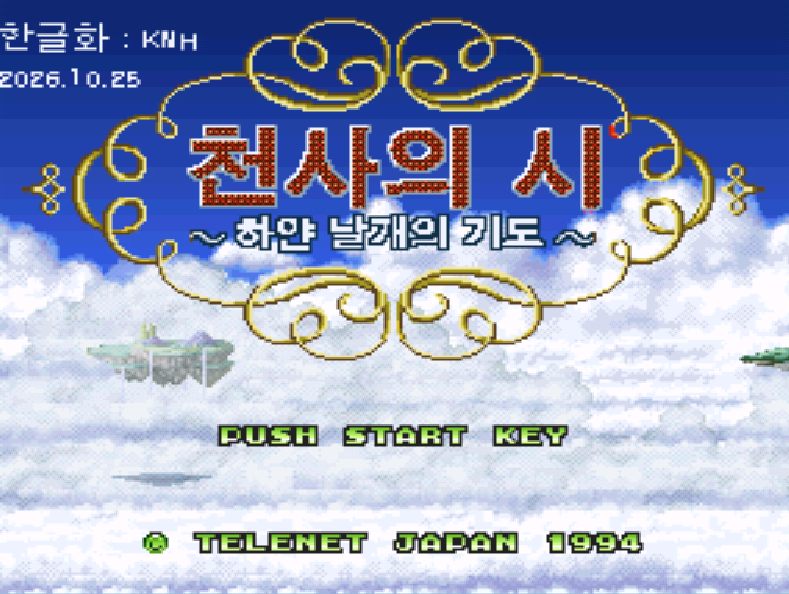
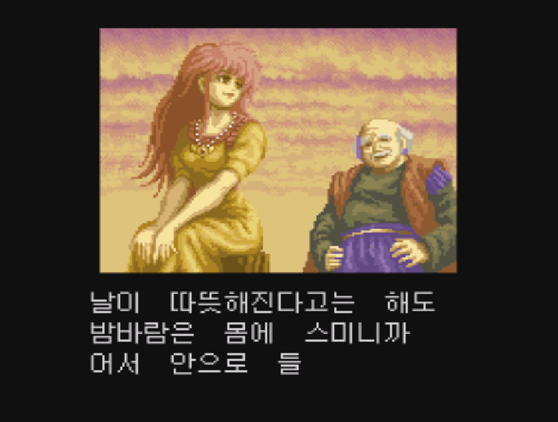
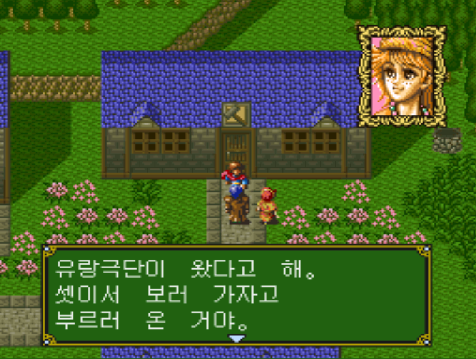
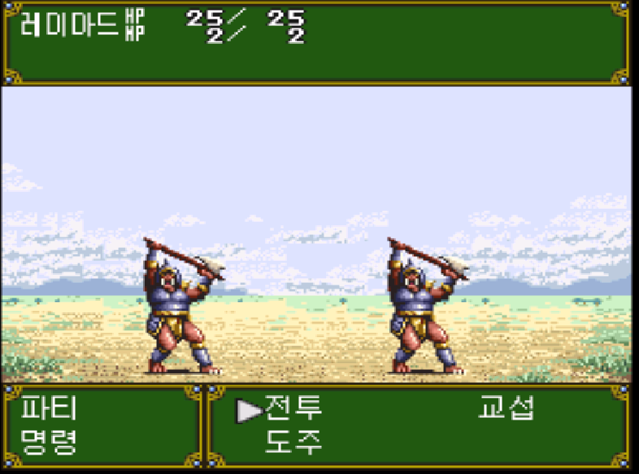

# 천사의 시 ―하얀 날개의 기도― (SFC) 한글 패치

슈퍼 패미컴 게임 「천사의 시 ―하얀 날개의 기도―」의 한국어 번역 패치입니다.

별칭: Tenshi no Uta: Shiroki Tsubasa no Inori / 天使の詩 白き翼の祈り / 한글 패치 · Korean translation patch

## 샘플

## 필요한 것

- 원본 롬 
- 512바이트 복사기 헤더가 없어야 합니다. 있으면 제거한 뒤 사용하세요.

## 적용 방법

① **브라우저 적용(권장)**: `patcher/index.html`을 브라우저로 열거나 [웹 페이지](https://komandoo9898.github.io/tenshi-no-uta-sfc-korean-patch/patcher/)에 접속해 원본 롬을 선택하면 패치된 롬이 내려받아집니다. 롬은 브라우저 밖으로 나가지 않습니다.
② **IPS 패처**: Releases의 `.ips` 파일을 Flips 또는 Lunar IPS로 원본 롬에 적용합니다.

- 결과 롬: 2,097,152바이트, SHA-256 
## 다운로드

[Releases](../../releases)에서 최신 `.ips` 파일을 받으세요.

## 알려진 문제

- 이동지 선택 창, 전투 대상 선택의 몬스터 이름 등 일부 화면은 일본어로 표시될 수 있습니다.

## 크레딧

- 한글화: KNH 2026.10.25
- 원작: 개발 Riot / 발매 Telenet Japan (1994-07-29, 슈퍼 패미컴)

## 면책 및 라이선스

- 비영리 팬 번역입니다. 게임의 저작권은 각 권리자에게 있습니다.
- 이 저장소에는 게임 데이터와 롬이 포함되지 않습니다. 정식으로 입수한 원본 롬이 필요합니다.
- 권리자가 요청하면 배포를 중단하고 관련 파일을 삭제합니다.
- 이 저장소의 문서는 MIT 라이선스를 따릅니다 (`LICENSE` 참고).
